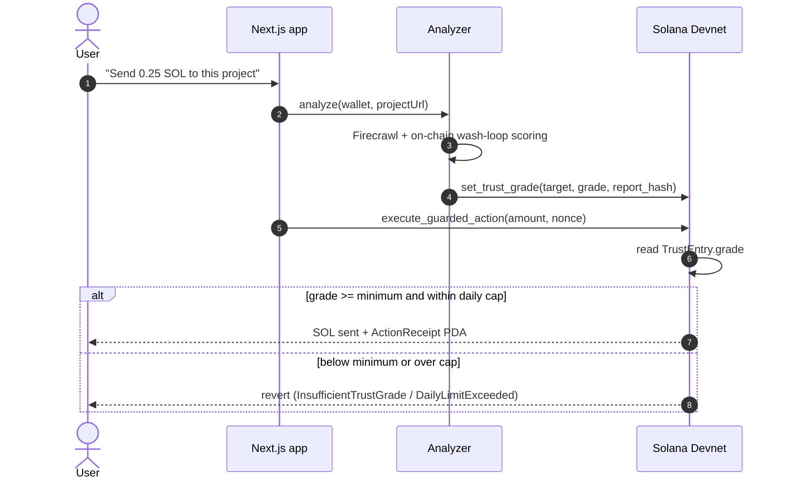
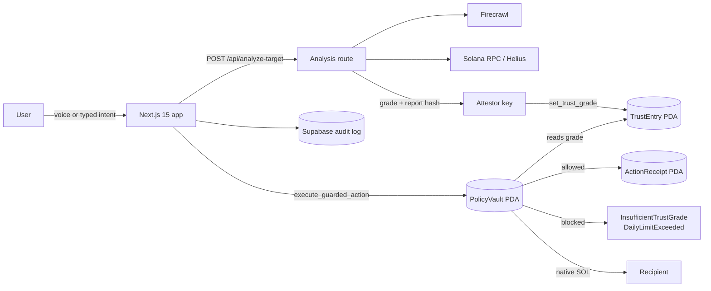

<p align="center">
  <picture>
    <source media="(prefers-color-scheme: dark)" srcset="public/brand/solvox-logo-notag-mono-white.png">
    <source media="(prefers-color-scheme: light)" srcset="public/brand/solvox-logo-notag-dark.png">
    
  </picture>
</p>

<h1 align="center">The on-chain trust and policy firewall for Solana</h1>

<p align="center">
  <strong>Speak. Verify. Execute.</strong><br>
  An AI agent investigates a recipient's live website and wallet history. An Anchor program enforces your spend and trust rules before a single lamport moves.
</p>

<p align="center">
  <a href="https://nextjs.org"></a>
  <a href="https://react.dev"></a>
  <a href="https://www.typescriptlang.org"></a>
  <a href="https://tailwindcss.com"></a>
  <a href="https://www.anchor-lang.com"></a>
  <a href="https://explorer.solana.com/address/GQqUyuyVnf9vHG3hzHztPt53nZyRSjnrmjLSmEabRNjc?cluster=devnet"></a>
  <a href="LICENSE"></a>
</p>

<p align="center">
  <a href="#getting-started">Quickstart</a> ·
  <a href="#architecture">Architecture</a> ·
  <a href="#on-chain-design">On-chain design</a> ·
  <a href="#api-reference">API</a> ·
  <a href="#security-model">Security</a> ·
  <a href="#license">License</a>
</p>

<p align="center">
  <a href="https://explorer.solana.com/address/GQqUyuyVnf9vHG3hzHztPt53nZyRSjnrmjLSmEabRNjc?cluster=devnet"><strong>View the deployed program on Solana Explorer</strong></a>
</p>

---

> **The pitch**
>
> Sending crypto is a leap of faith. SolVox turns that leap into a checked transaction: a voice-first agent reads the project site with Firecrawl, scores the wallet's on-chain history for wash loops, writes an A-to-F trust grade to a PDA, and then an Anchor `PolicyVault` decides whether the transfer is allowed. The model proposes. The program decides.

## Table of contents

- [The problem](#the-problem)
- [The guardrail](#the-guardrail)
- [How it works](#how-it-works)
- [Architecture](#architecture)
- [On-chain design](#on-chain-design)
- [Tech stack](#tech-stack)
- [Repository layout](#repository-layout)
- [Getting started](#getting-started)
- [Environment variables](#environment-variables)
- [API reference](#api-reference)
- [Frontend routes](#frontend-routes)
- [Demo script](#demo-script)
- [Security model](#security-model)
- [Build status](#build-status)
- [Roadmap](#roadmap)
- [Hackathon tracks](#hackathon-tracks)
- [Team](#team)
- [Contributing](#contributing)
- [License](#license)

---

## The problem

A wallet address tells you almost nothing. A polished landing page tells you even less. Scams on Solana rarely fail because the transfer is technically broken. They succeed because the sender has no fast, legible way to answer three questions:

1. **Who is on the other side?** Is there a real project, docs, and a traceable team, or a page cloned yesterday?
2. **Does the wallet behave like a business or a loop?** New wallet, two counterparties, and 85 percent reciprocal transfers is not organic activity.
3. **Can I enforce my own rules?** A warning in a chat window is advisory. A daily cap and a minimum trust grade enforced by a program are not.

SolVox answers all three in one loop, and it keeps the decision where it belongs: on-chain.

## The guardrail

Most "AI crypto assistant" demos put the model in the critical path. SolVox deliberately does not.

> [!IMPORTANT]
> The trust grade is never passed as an instruction argument. `execute_guarded_action` reads `TrustEntry.grade` directly from the PDA and reverts with `InsufficientTrustGrade` when the policy is violated. A prompt injection, a compromised frontend, or a hallucinating model cannot talk the program past your rules.

The model and the UI can propose. Only the Anchor program can approve. That separation is the product.

## How it works

Three moves, one guardrail.

### 1. Speak

Describe the transfer in plain language, or type the wallet and project URL. ElevenLabs Scribe turns voice into intent; the parsed command is shown back before anything moves.

### 2. Verify

Firecrawl reads the live project site for red flags and citations. A scorer reads the wallet's transaction history for age, counterparty diversity, and reciprocal wash loops. The result becomes a grade:

| Grade | Score band | Meaning | Vault behavior at minimum B |
|:---:|:---:|---|---|
| **A** | 85-100 | Trusted | Settles |
| **B** | 70-84 | Healthy | Settles |
| **C** | 50-69 | Watch | Reverts |
| **D** | 30-49 | Risky | Reverts |
| **F** | 0-29 | Blocked | Reverts |

The backend attestor writes the grade and a SHA-256 report hash to the target's `TrustEntry` PDA.

### 3. Execute

The owner or delegate submits `execute_guarded_action`. The program:

- loads the vault and resets the daily counter after 24 hours;
- reads `TrustEntry.grade` and compares it to `min_trust_grade`;
- checks `spent_today + amount <= daily_spend_limit` with overflow protection;
- keeps the vault above the rent-exempt minimum;
- transfers native SOL and writes an immutable `ActionReceipt` PDA.

A blocked payment is a feature working, not an apology. The UI surfaces the exact Anchor error and links the transaction on Explorer.



## Architecture



Two planes, one source of truth:

- **Off-chain plane:** voice, scraping, scoring, citations, audit history. Fast, replaceable, and explicitly advisory.
- **On-chain plane:** the vault policy, the attested grade, the transfer, and the receipt. Slow, deterministic, and authoritative.

## On-chain design

**Program:** `solvox`
**Program ID:** `GQqUyuyVnf9vHG3hzHztPt53nZyRSjnrmjLSmEabRNjc`
**Cluster:** Devnet
**Runtime:** Anchor 0.30.1, native SOL only

### Accounts (PDAs)

| Account | Seeds | Purpose | Size |
|---|---|---|---:|
| `PolicyVault` | `["vault", owner]` | Daily cap, spend tracker, minimum grade, delegate, pause flag | 99 bytes |
| `TrustEntry` | `["trust", target]` | Attested grade, attestor, report hash, timestamp | 114 bytes |
| `ActionReceipt` | `["receipt", vault, nonce_le_u64]` | Immutable proof of an allowed action | 98 bytes |

<details>
<summary><strong>Account layouts</strong></summary>

```rust
pub struct PolicyVault {
    pub owner: Pubkey,              // 32
    pub delegate_agent: Pubkey,     // 32
    pub daily_spend_limit: u64,     // 8  lamports
    pub spent_today: u64,           // 8  lamports
    pub last_reset_ts: i64,         // 8  unix seconds
    pub min_trust_grade: u8,        // 1  1=F .. 5=A
    pub paused: bool,               // 1
    pub bump: u8,                   // 1
}

pub struct TrustEntry {
    pub target: Pubkey,             // 32
    pub attestor: Pubkey,           // 32
    pub grade: u8,                  // 1  1=F .. 5=A
    pub report_hash: [u8; 32],      // 32 SHA-256 of the analysis report
    pub updated_at: i64,            // 8
    pub bump: u8,                   // 1
}

pub struct ActionReceipt {
    pub vault: Pubkey,              // 32
    pub target: Pubkey,             // 32
    pub amount: u64,                // 8
    pub grade_at_execution: u8,     // 1
    pub timestamp: i64,             // 8
    pub nonce: u64,                 // 8
    pub bump: u8,                   // 1
}
```

</details>

### Instructions

| Instruction | Args | Authorization | What it does |
|---|---|---|---|
| `initialize_vault` | `daily_spend_limit`, `min_trust_grade`, `delegate_agent` | Owner signer | Creates the owner's `PolicyVault` PDA |
| `deposit_vault` | `amount` | Owner signer | Transfers native SOL into the vault PDA |
| `update_policy` | `daily_spend_limit`, `min_trust_grade`, `paused` | Owner only (`has_one`) | Changes rules or pauses the vault |
| `set_trust_grade` | `grade`, `report_hash` | Attestor signer | Creates or updates a target's `TrustEntry` |
| `execute_guarded_action` | `amount`, `nonce` | Payer must be owner or delegate | Enforces policy, transfers SOL, writes receipt |
| `withdraw_vault` | `amount` | Owner only (`has_one`) | Returns SOL to the owner above rent minimum |

### Error codes

| Code | Name | Message |
|---|---|---|
| `6000` | `InvalidGrade` | Trust grade must be between 1 (F) and 5 (A). |
| `6001` | `InvalidAmount` | Amount must be greater than zero. |
| `6002` | `VaultPaused` | PolicyVault is currently paused. |
| `6003` | `UnauthorizedCaller` | Caller is not authorized to execute on this vault. |
| `6004` | `InsufficientTrustGrade` | Target wallet trust grade is below PolicyVault minimum. |
| `6005` | `DailyLimitExceeded` | Transfer exceeds PolicyVault daily spend limit. |
| `6006` | `InsufficientVaultBalance` | Insufficient SOL balance in PolicyVault. |

Anchor offsets are `0x1770` through `0x1776`. The frontend decodes both the hex form and the readable name in `src/lib/program.ts`.

### Why three PDAs

- **PolicyVault** is the owner's rulebook. One vault per owner keeps the mental model simple.
- **TrustEntry** is keyed by the target, not the owner. A grade is reusable across every vault that sees the same wallet.
- **ActionReceipt** is keyed by vault and a caller-supplied nonce. Every allowed action gets a unique, permanent proof.

## Tech stack

| Layer | Choice | Why |
|---|---|---|
| Frontend | Next.js 15 (App Router), React 19, TypeScript | Server-rendered marketing page plus a wallet-heavy client dashboard |
| Styling | Tailwind CSS 4, self-hosted Inter / Montserrat / JetBrains Mono | Deterministic builds, no external font fetch, mono for hashes |
| Motion | CSS keyframes + IntersectionObserver, canvas 3D hero | Fast, reduced-motion aware, no animation runtime dependency |
| Wallet | Solana Wallet Adapter (Phantom, Solflare) | Devnet-ready with minimal integration surface |
| Program | Anchor 0.30.1 on Solana | Typed accounts, PDA constraints, readable errors |
| Web3 client | `@solana/web3.js` + direct Borsh instruction encoding | Avoids IDL-version mismatches between Anchor 0.29 exports and 0.30 clients |
| AI research | Firecrawl | Live site scraping and citations for the trust report |
| Voice | ElevenLabs (Scribe STT, TTS) | Voice input and spoken verdicts |
| Persistence | Supabase Postgres + RLS | Audit log for reports and receipts |
| RPC | Helius / Solana devnet RPC | Wallet history and transaction confirmation |

## Repository layout

```text
solvox/
├─ programs/solvox/src/lib.rs      Anchor program: vault, trust registry, receipts
├─ tests/solvox.ts                 End-to-end program tests
├─ Anchor.toml                     Devnet program ID and test config
├─ src/
│  ├─ app/
│  │  ├─ page.tsx                  Marketing landing page
│  │  ├─ dashboard/                Wallet-connected command center
│  │  ├─ api/                      Analyze, voice, and receipts routes
│  │  └─ globals.css               Design tokens, keyframes, utilities
│  ├─ components/
│  │  ├─ PolicyVaultCard.tsx       Vault setup, deposit, policy, withdraw
│  │  ├─ TargetInspectorCard.tsx   Manual/voice inspection and citations
│  │  ├─ ExecutionFeedCard.tsx     Guarded execution and receipt feed
│  │  ├─ motion/                   Hero 3D, reveal, count-up, marquee, terminal
│  │  └─ ui/CardShell.tsx          Shared card primitive
│  ├─ lib/
│  │  ├─ constants.ts              Program ID, grade maps, Explorer helpers
│  │  ├─ pda.ts                    Vault, trust, and receipt PDA derivation
│  │  ├─ program.ts                Instruction builders, account fetchers, errors
│  │  ├─ grades.ts                 Grade palette and labels
│  │  └─ types.ts                  Shared TypeScript domain types
│  └─ idl/solvox.json              Exported program IDL
├─ supabase/schema.sql             Reports and receipts tables with RLS
├─ public/brand/                   Logos and icons
└─ docs/                           Hackathon docs and UI research
```

## Getting started

### Prerequisites

| Tool | Version | Needed for |
|---|---|---|
| Node.js | 20+ (22 tested) | App, scripts |
| npm | 10+ | Dependency install |
| Solana CLI | 1.18+ | Program build and deploy only |
| Anchor | 0.30.1 | Program build, tests, deploy only |
| Rust | stable | Program build only |
| Supabase project | any | Audit persistence (optional for UI demo) |

You can run the landing page and dashboard without the Solana toolchain. The program is already deployed to devnet.

### 1. Clone and install

```bash
git clone https://github.com/toluwanibakare/dev3pack.git
cd dev3pack
npm install
```

### 2. Configure environment

```bash
cp .env.example .env.local
```

Fill in at least `NEXT_PUBLIC_SOLANA_RPC_URL`. The program ID has a working devnet fallback, so the dashboard can connect immediately.

### 3. Create the Supabase tables (optional)

Open the Supabase SQL editor and run [`supabase/schema.sql`](supabase/schema.sql). It creates `verification_reports` and `action_receipts` with public read policies.

### 4. Run the app

```bash
npm run dev
```

| Route | What it is |
|---|---|
| `http://localhost:3000/` | Landing page |
| `http://localhost:3000/dashboard` | Command center (wallet required) |

### 5. Build and deploy the program (only if you change Rust)

```bash
anchor build
anchor keys list
# update declare_id! and Anchor.toml if the program key changed
anchor deploy --provider.cluster devnet
```

Verify the deployed program:

```bash
solana program show GQqUyuyVnf9vHG3hzHztPt53nZyRSjnrmjLSmEabRNjc --url devnet
```

### 6. Test the program

The tests need the Anchor toolchain plus a small Mocha/Chai runner that is not part of the default app dependencies:

```bash
npm install --save-dev chai @types/chai mocha @types/mocha ts-mocha ts-node
anchor test
```

The suite covers vault initialization and deposit, a Grade F rejection, a daily-limit rejection, and a successful Grade A transfer with a receipt assertion.

## Environment variables

| Variable | Scope | Required | Purpose |
|---|---|:---:|---|
| `NEXT_PUBLIC_SOLANA_RPC_URL` | Client | Recommended | Devnet RPC endpoint (defaults to public devnet) |
| `NEXT_PUBLIC_SOLVOX_PROGRAM_ID` | Client | No | Overrides the deployed program ID |
| `ATTESTOR_PRIVATE_KEY` | Server only | For attestation | Signs `set_trust_grade` |
| `FIRECRAWL_API_KEY` | Server only | For analysis | Live site scraping and citations |
| `ELEVENLABS_API_KEY` | Server only | For voice | Scribe STT and TTS |
| `ELEVENLABS_VOICE_ID` | Server only | For voice | Voice profile for spoken verdicts |
| `NEXT_PUBLIC_SUPABASE_URL` | Client | For audit log | Supabase project URL |
| `NEXT_PUBLIC_SUPABASE_ANON_KEY` | Client | For audit log | Public read access under RLS |
| `SUPABASE_SERVICE_ROLE_KEY` | Server only | For writes | Server-side inserts for reports and receipts |

> [!WARNING]
> Never expose `ATTESTOR_PRIVATE_KEY` or `SUPABASE_SERVICE_ROLE_KEY` to the browser. Only `NEXT_PUBLIC_*` values are bundled.

## API reference

| Route | Method | State | Contract |
|---|---|---|---|
| `/api/analyze-target` | `POST` | Interface ready, integration pending | `{ wallet, projectUrl }` to an `AnalysisResult` |
| `/api/voice/transcribe` | `POST` | Interface ready, integration pending | Audio form data to transcript and intent |
| `/api/voice/speak` | `POST` | Interface ready, integration pending | Text to an audio stream |
| `/api/receipts` | `GET` | Live (empty until Supabase is wired) | `{ receipts: ReceiptLogItem[] }` |
| `/api/receipts` | `POST` | Interface ready, integration pending | Persists a receipt |

The UI calls these routes today. Until the backend keys are configured, they return `501` with a clear message, and the dashboard still supports full vault management and on-chain guarded execution for wallets that already have a `TrustEntry`.

<details>
<summary><strong>Example analysis response</strong></summary>

```json
{
  "wallet": "8xJk...pQ2f",
  "projectUrl": "https://example-project.xyz",
  "grade": "F",
  "gradeNumeric": 1,
  "score": 18,
  "redFlags": [
    "No documentation or named team found on the project site",
    "85 percent circular transfers with two counterparties"
  ],
  "washLoopMetrics": {
    "walletAgeDays": 3,
    "txCount": 24,
    "uniqueCounterparties": 2,
    "reciprocalRatio": 0.85
  },
  "citations": [
    { "title": "Project landing page", "url": "https://example-project.xyz" }
  ],
  "reportHash": "4f9c...e1a2",
  "attestTxSignature": "5xQ2...f9Kd"
}
```

</details>

## Frontend routes

| Route | Type | Notes |
|---|---|---|
| `/` | Static marketing page | Hero, stats, live-style terminal feed, how it works, trust grades, developer cards |
| `/dashboard` | Client command center | Wallet adapter, vault card, target inspector, execution feed |

The dashboard is intentionally isolated behind its own `SolanaProvider` layout so the landing page ships without wallet JavaScript.

## Demo script

A two-minute walkthrough for judges:

1. Open `/dashboard` and connect Phantom on devnet.
2. Create a vault with a `0.5 SOL` daily cap, minimum grade `B`, and delegate set to your wallet.
3. Deposit `1 SOL`.
4. Inspect a seeded scam target: the analysis returns grade `F` with citations and a wash-loop metric.
5. Try to send `0.1 SOL`. The transaction reverts with `InsufficientTrustGrade`. Open the Explorer link.
6. Inspect a clean target: grade `A`, then send `0.25 SOL`. It confirms and writes an `ActionReceipt` PDA.
7. Try a `0.8 SOL` transfer to the clean target: `DailyLimitExceeded`.
8. Withdraw the remainder. The vault returns to the owner above rent minimum.

## Security model

### Enforced on-chain

- **Grade comes from the PDA.** `execute_guarded_action` never accepts a grade argument.
- **Owner-only policy changes.** `update_policy`, `withdraw_vault`, and vault owner checks use `has_one = owner`.
- **Bounded payer.** The receipt payer must equal the vault owner or the configured delegate.
- **Daily cap with overflow protection.** `checked_add` before comparison.
- **Rent-exempt floor.** Transfers cannot drain the vault below its rent minimum.
- **Immutable receipts.** Each allowed action creates a unique receipt keyed by vault and nonce.

### Trust boundaries and known limitations

| Area | Current state | Hardening path |
|---|---|---|
| Attestor trust | `set_trust_grade` accepts a signer; the backend attestor is trusted | Add an allowlist or registry constraint on the attestor key |
| Grade source | Off-chain Firecrawl + RPC scoring, attested on-chain | Decentralized or ZK attestation, multiple independent attestors |
| Asset support | Native SOL only | SPL Token and Token-2022 vaults |
| Network | Devnet only | Mainnet review, audit, and operational key management |
| Daily reset | Lazy reset on the next execution after 24 hours | Keeper or cron-assisted reset for precise windows |
| API layer | Routes are scaffolded | Wire Firecrawl, RPC scorer, ElevenLabs, Supabase |

> [!NOTE]
> SolVox is a hackathon reference implementation. The on-chain vault constraints are real. The attestor is a trusted component in this version, and the README says so on purpose.

## Build status

| Surface | State |
|---|---|
| Anchor program on devnet | Live |
| Policy vault create, deposit, update, withdraw | Live |
| Guarded execution with on-chain error decoding | Live |
| On-chain `TrustEntry` reads | Live |
| Wallet connection (Phantom, Solflare) | Live |
| Landing page and dashboard | Live |
| Firecrawl and RPC analysis route | Scaffolded |
| ElevenLabs voice routes | Scaffolded |
| Supabase persistence | Scaffolded |

## Roadmap

| Horizon | Work |
|---|---|
| Before submission | Wire Firecrawl and RPC scoring, attest real grades, persist reports, seed demo wallets, record the demo |
| Next | Attestor allowlist, multi-attestor quorum, SPL Token support, Playwright end-to-end tests |
| Later | Mainnet audit, delegated policy templates, reputation marketplace for attestors, ZK proofs of off-chain analysis |

## Hackathon tracks

Built for the **Dev3pack x Solana Global Online Hackathon**:

- Best App Overall on Solana
- Best Solana app using Firecrawl
- Best Solana app built with ElevenLabs
- Dev3pack Local - Nigeria
- Best Agentic App on Solana
- Best Solana app using Supabase

## Team

| Member | Role | Ownership |
|---|---|---|
| Toluwanibakare | Frontend and Web3 | Anchor program, vault and execution UI, wallet integration, design system |
| Olamzy | Backend | Firecrawl and RPC scoring, attestor, ElevenLabs, Supabase, deployment |
| Ahmad | Ops, QA, Pitch | Keys and infra, demo wallets, end-to-end QA, demo video, submission |

## Contributing

1. Fork the repository and create a feature branch from `main`.
2. Keep the security invariant intact: never accept a trust grade as an execution argument.
3. Run `npx tsc --noEmit` and `npm run build` before opening a pull request.
4. Use conventional commit messages and describe the on-chain impact of the change.
5. Open a pull request against `main`. Do not commit secrets.

## License

Released under the [MIT License](LICENSE).

<p align="center">
  <sub>Built with Anchor, Next.js, Firecrawl, ElevenLabs, and Supabase. Devnet only. Not financial advice.</sub>
</p>